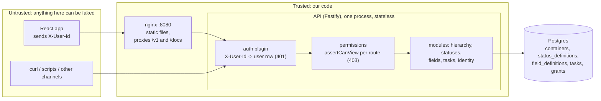
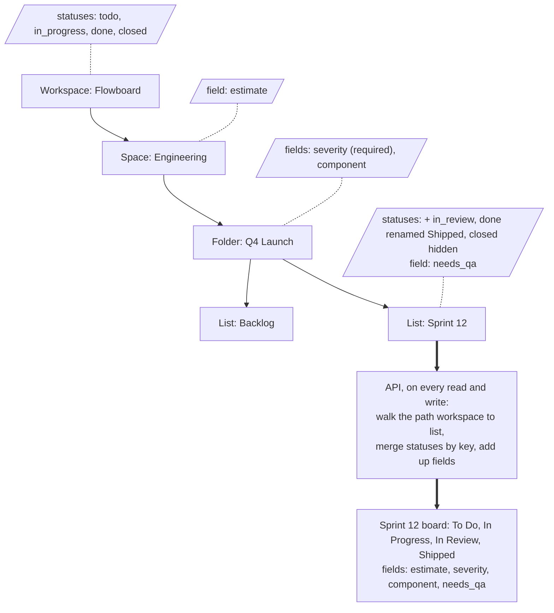
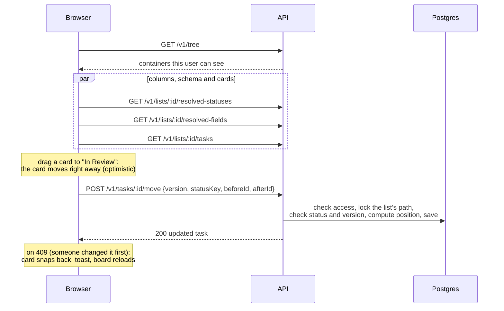

# Flowboard

A small project-management app: a workspace tree (workspace > space > folder > list), tasks shown as a kanban board or a table, statuses and custom fields that depend on where a list sits, and per-user permissions.

Built for the "Lead Engineer (Full Stack), Tasks module" take-home. Node.js + TypeScript (Fastify) API, React + TypeScript web app, Postgres.

- Live demo: https://flowboard-web-l6c1.onrender.com (Render free plan: the app sleeps after 15 idle minutes, so the first load after that can take up to a minute)
- Demo video: https://youtu.be/TaNQ26_sjKk
- Design, in plain language: [`docs/DESIGN.md`](docs/DESIGN.md)
- Every decision with the options I rejected: [`docs/DECISIONS.md`](docs/DECISIONS.md)
- How AI was used, including its mistakes: [`AI_USAGE.md`](AI_USAGE.md)

## Run it

Needs only Docker.

```sh
docker compose up --build      # or: make up
```

| What     | Where                                                           |
| -------- | --------------------------------------------------------------- |
| Web app  | http://localhost:8080                                           |
| API      | http://localhost:8080/v1 (also directly on :3000)               |
| API docs | http://localhost:8080/docs (OpenAPI, generated from the code)   |
| Postgres | localhost:5432, user/password `flowboard` (from `.env.example`) |

The first start creates the tables and loads demo data. `make seed` resets the data. `make down` stops everything. Ports and the database password can be changed in `.env` (copy `.env.example`; it has no secrets).

**Users** (pick one in the header; this is a mock login):

| User  | Role   | Grants                     | Sees                                                 |
| ----- | ------ | -------------------------- | ---------------------------------------------------- |
| Alice | admin  | none needed                | everything, plus the Settings pages                  |
| Bob   | member | denied on the On-call list | Engineering without On-call; not Marketing (private) |
| Carol | member | allowed on Marketing       | everything                                           |

**Demo data:** one workspace (Flowboard), two spaces (Engineering, and Marketing which is private), three folders, four lists, 25 tasks, 7 custom fields at three levels. Lists in the same folder have different boards: Backlog shows To Do, In Progress, Done, Closed; Sprint 12 adds In Review, renames Done to "Shipped" and hides Closed.

### Deploy (Render)

[`render.yaml`](render.yaml) runs the same images on Render's free plan: Postgres 18 (the schema uses `uuidv7()`), the API (migrations and seed run on start), and the web app. nginx forwards `/v1` to the API's public URL, set in `API_UPSTREAM`.

On the free plan a service sleeps after 15 idle minutes. A scheduled GitHub Action ([`keep-alive.yml`](.github/workflows/keep-alive.yml)) calls the API's `/health` every 10 minutes so it stays awake; keeping both services awake would go over the plan's 750 hours a month. The web app may sleep, and then its first load takes about 15 seconds. If the API does fall asleep (a late scheduled run), the app wakes it and retries, which takes up to a minute. The free database expires after 30 days.

The deployed app keeps the mock login, so anyone with the link can act as any user and change the demo data. That's fine for a demo. Real login is planned in the "Auth in production" section below.

## Tests

```sh
make test
```

Runs, in Docker:

1. **API and unit tests** (80 API, 10 validator): every API request goes through the real HTTP stack (`app.inject`) against a real Postgres test database, reset and re-seeded before each test. They cover the PDF's scenarios (permissions, sibling lists resolving differently, unknown status, cross-list move, field type and option checks, required fields, in-use status safety) plus field changes, stale versions, ordering and paging. Pure logic (status merging, the shared field validator) has unit tests too. 41 of the HTTP tests are negative: they assert the refusal (status code, error code, the `details` path) and, for refused writes, that the database row is unchanged.
2. **Component test** (7): each custom field type renders the right input and sends the value in the shape the API expects.
3. **Browser tests** (2, Playwright): open Sprint 12, check its four columns, edit Estimate, save, reload and see the value persisted. Then: Alice sees the private "Launch Content" list, switching to Bob removes it, and opening its URL directly shows "no access".

The browser tests run against the running stack and its demo data; the edit test writes a random value so it can run again. Locally (with Node 24 and `pnpm install`): `pnpm test` for the API, unit and component tests (needs the Docker Postgres up), and `pnpm --filter @flowboard/web e2e` for the browser tests against :8080. CI runs typecheck, lint, format check and `pnpm test` on every push.

Not covered by automated tests: drag and drop itself, the optimistic rollback on a conflict (checked by hand), and the settings screens. The rules behind them are tested in the API.

## System design



- **Trust boundary:** the API trusts nothing from the client. The user comes from a database lookup of `X-User-Id`; the role comes from the database, never from the request. Every input is validated with the same Zod schemas that generate the OpenAPI docs.
- **Where permissions are enforced:** in the API, in every route that takes a container, list or task id, before any work (`apps/api/src/modules/permissions/service.ts`). The tree endpoint returns only what the user can see. The UI hides things too, but that's only convenience.
- **Where statuses and custom fields are resolved:** in the API, on every read and write, by walking the list's path from the workspace down (`modules/statuses/resolve.ts`, `modules/fields/service.ts`). Nothing is cached, so a config change shows up on the next request.
- **Shared contracts:** `packages/contracts` holds the request and response schemas and the custom field validator. The API and the web app import the same code, so the form can't accept what the API would reject.

**Where statuses and custom fields live relative to the tree:**



Status and field definitions are rows attached to a container (`status_definitions.container_id`, `field_definitions.container_id`). Nothing is copied into lists: a list's columns and fields are computed from its path when needed, so a change at the space level reaches every list below it on the next request.

**Loading a board, then dragging a card:**



## Data model

| Table                | Holds                                                                                                                         |
| -------------------- | ----------------------------------------------------------------------------------------------------------------------------- |
| `users`              | Alice, Bob, Carol, with a role (admin or member)                                                                              |
| `containers`         | the whole tree in one table: workspace, spaces, folders, lists (`type`, `parent_id`, `position`, `visibility`, `archived_at`) |
| `status_definitions` | status rows attached to a container: a new status, or a change to an inherited one                                            |
| `field_definitions`  | custom fields attached to a space, folder or list                                                                             |
| `tasks`              | tasks, with `status_key`, `custom_fields` (JSON), `position`, `version`                                                       |
| `task_assignees`     | one row per task and user                                                                                                     |
| `grants`             | allow or deny, per user, per container                                                                                        |

**The tree.** Postgres enforces its shape: a composite foreign key `(parent_id, parent_type) -> (id, type)` plus a check on allowed pairs means a folder can only sit in a space, a list only in a folder, and tasks only in lists. Only one workspace can exist (partial unique index). Containers are archived, not deleted (D-11). Siblings are ordered by fractional index strings, so a reorder updates one row (D-12).

**Status inheritance (merge by key).** Walk the list's path from the workspace down, building a map from status key to status:

- a row with a key not seen above **adds** a status;
- a row with a key seen above **overrides** its name, color or position, or **hides** it;
- the category (not started, active, done, closed) always comes from the level that first defined the key.

The board's columns are the visible statuses in position order. Every change is applied, then checked for every list under the changed container, inside one transaction; if any list would lose its last not started, active or done status, or any task would lose its column, the change is refused with 409 and details, and nothing is saved (D-05, D-07). Tasks store the status **key**, so renaming a status at one level doesn't touch tasks.

**Custom field resolution.** A list's fields are all fields defined on its path (space, folder, list). Fields add up and are never overridden. Keys are unique in the workspace, so `estimate` is a number everywhere and a task keeps its values when it moves (D-08). Values are validated against the list's resolved fields on create, edit and move: wrong type or unknown option is 400 with the field's path; a required field missing on create or move is 400. Deleting a field archives it: values stay in the database but aren't returned. Changing a field's type, or removing an option, that tasks use is refused with 409 (D-09).

**Moving a task to another list:** keep the same status key if the new list has it, else the first status of the same category, else 409 `STATUS_UNMAPPABLE` (the client can pick a status explicitly). Required fields of the new list must be sent in the move request (D-10).

**Permissions:** a member sees a container only if every container on its path passes: an allow grant passes, a deny grant fails, otherwise public passes and private fails. So a deny or a private space hides everything below it. Admins see everything. Seen-but-forbidden is 403, missing is 404 (D-15, D-34). Only admins change containers, statuses and fields (D-13).

## API

REST under `/v1`; the full, live reference is at http://localhost:8080/docs.

| Method               | Path                                                               | Who                 |
| -------------------- | ------------------------------------------------------------------ | ------------------- |
| GET                  | `/health`, `/ready`                                                | anyone              |
| GET                  | `/v1/me`, `/v1/users`                                              | any user            |
| GET                  | `/v1/tree`                                                         | any user (filtered) |
| POST                 | `/v1/containers`                                                   | admin               |
| GET / PATCH / DELETE | `/v1/containers/:id`                                               | can view / admin    |
| POST                 | `/v1/containers/:id/move` (reorder among siblings)                 | admin               |
| GET                  | `/v1/containers/:id/statuses` (own rows + merged result)           | can view            |
| PUT / DELETE         | `/v1/containers/:id/statuses/:key`                                 | admin               |
| GET / POST           | `/v1/containers/:id/fields`                                        | can view / admin    |
| PATCH / DELETE       | `/v1/fields/:id`                                                   | admin               |
| GET                  | `/v1/lists/:id/resolved-statuses`, `/v1/lists/:id/resolved-fields` | can view            |
| GET / POST           | `/v1/lists/:id/tasks`                                              | can view            |
| GET / PATCH / DELETE | `/v1/tasks/:id`                                                    | can view            |
| POST                 | `/v1/tasks/:id/move` (column, order and list)                      | can view both lists |

**Conventions:**

- **Errors** always look like `{ "error": { "code", "message", "details"? } }`. 400 bad input (details have a `path` per problem), 401 no or unknown user, 403 not allowed, 404 missing, 409 conflicts with current data.
- **Pagination** is cursor-based on collections that grow (users, tasks): `?limit=&cursor=`, response `{ data, page: { limit, nextCursor, hasMore } }`. Complete sets the UI renders whole (tree, a list's statuses and fields) return `{ data }`.
- **Concurrency:** task edits and moves send the `version` they're based on; a stale one gets 409 `VERSION_CONFLICT`. Moves send neighbor ids (`beforeId` above, `afterId` below), and the server computes the position.
- **Commands as endpoints:** changing a task's column, order or list goes through `POST /tasks/:id/move`, so all the move rules live in one place (D-24).
- **Tracing:** every response has `x-request-id` (reused from the request if sent), also in the logs.

## Auth and other channels

**Auth (mock).** Every request sends `X-User-Id: alice | bob | carol`. A Fastify plugin looks the handle up in `users`: missing or unknown is 401. The rest of the code only reads `request.user`. The web app remembers the picked user in localStorage and picks Alice when nothing is stored (a new or incognito window). That is only a demo convenience in the browser: the API itself still returns 401 without the header.

**Auth in production.** Replace that one plugin with OIDC login:

- **Browser:** the authorization code flow with PKCE goes through the API (`/v1/auth/login`, `/callback`, `/logout`). The API keeps a server-side session and sets an `HttpOnly; Secure; SameSite=Lax` cookie, so no token ever reaches JavaScript. nginx serves the app and the API from one origin, so the cookie is first-party.
- **Scripts and mobile:** `Authorization: Bearer <token>` from the same provider, verified locally against its JWKS.
- **Both paths** map the provider's `(issuer, subject)` to a row in `users`. The role and grants still come from our database, never from token claims.

Routes, permissions and tests don't change, and the tests keep the header as a dev-only mock mode. Full plan in [DESIGN.md section 9](docs/DESIGN.md#9-login-mock).

**Second channel: curl / scripts.** The same API, same auth header, same errors. Outputs below are from the running app.

```sh
API=http://localhost:8080/v1

# Who am I? Bob's tree has no Marketing and no On-call.
curl -s $API/me -H 'X-User-Id: alice'
curl -s $API/tree -H 'X-User-Id: bob' | jq -r '.data[].name'

# Sprint 12's columns
LIST=$(curl -s $API/tree -H 'X-User-Id: alice' | jq -r '.data[] | select(.name == "Sprint 12") | .id')
curl -s $API/lists/$LIST/resolved-statuses -H 'X-User-Id: alice' | jq -r '.data[].name'
# To Do, In Progress, In Review, Shipped

# Tasks by due date, two per page; pass page.nextCursor back as ?cursor= for the next page
curl -s "$API/lists/$LIST/tasks?sort=dueDate&limit=2" -H 'X-User-Id: alice' | jq '{titles: [.data[].title], page}'

# Create a task (severity is required in this folder), then move it to In Review
ID=$(curl -s -X POST $API/lists/$LIST/tasks -H 'X-User-Id: alice' -H 'Content-Type: application/json' \
  -d '{"title":"Write release notes","statusKey":"todo","customFields":{"severity":"low","estimate":2}}' | jq -r .id)
curl -s -X POST $API/tasks/$ID/move -H 'X-User-Id: alice' -H 'Content-Type: application/json' \
  -d '{"version":1,"statusKey":"in_review"}'

# Same move again with the old version
# {"error":{"code":"VERSION_CONFLICT","message":"Someone changed this task since you loaded it. Reload and try again.","details":[{"currentVersion":2}]}}

# A string for a number field
curl -s -X PATCH $API/tasks/$ID -H 'X-User-Id: alice' -H 'Content-Type: application/json' \
  -d '{"version":2,"customFields":{"estimate":"5"}}'
# {"error":{"code":"VALIDATION_FAILED","message":"Invalid task","details":[{"path":"customFields.estimate","code":"invalid_type","message":"Expected a number"}]}}

# Bob reading a list he's denied on: 403
ONCALL=$(curl -s $API/tree -H 'X-User-Id: alice' | jq -r '.data[] | select(.name == "On-call") | .id')
curl -s $API/lists/$ONCALL/tasks -H 'X-User-Id: bob'
# {"error":{"code":"FORBIDDEN","message":"You don't have access to this container"}}
```

**Webhooks / events (designed, not built).** A "task updated" event would carry what changed, so a consumer doesn't have to diff:

```json
{
  "id": "01a173aa-0000-7000-8000-000000000001",
  "type": "task.moved",
  "occurredAt": "2026-10-25T10:00:00Z",
  "actor": { "id": "01a173a0-85b0-714b-9412-abbd8bacb971", "handle": "alice" },
  "task": {
    "id": "01a173aa-58f4-75eb-abad-548c2f13aa49",
    "listId": "01a173a0-85b2-7b8d-8ff6-5e0f21661790",
    "version": 2
  },
  "changes": { "statusKey": { "from": "todo", "to": "in_review" } }
}
```

**Channel boundaries.** Shared by every channel: the contracts package (schemas, validator), auth, permissions, and every business rule, because they all live in the API. UI-only: optimistic updates and rollback, the drag-and-drop gestures, URL state (view, sort, open task), and the settings screens. A mobile app would use the same endpoints; the board already needs only three reads, and `?statusKey=` loads one column at a time for small screens or large lists.

## Scalability and service boundaries

**Built:** one API process (a modular monolith) plus Postgres. The API keeps no state in memory, so more copies can run behind a load balancer. Modules (`hierarchy`, `statuses`, `fields`, `tasks`, `permissions`, `identity`) each own their tables and talk to each other through exported functions.

**Queries and indexes:**

- Tree: `containers (parent_id, position)`; the path to a list is a short recursive query (at most four levels).
- Board: the web app loads a list's tasks in board order and groups them by column; `tasks (list_id, status_key, position, id)` makes loading one column (`?statusKey=`, for very large lists) a single index range.
- Table sorts: `tasks (list_id, coalesce(due_date, 'infinity'), id)` (the same expression the query sorts by, so undated tasks come last) and `(list_id, priority, id)`. Cursors are keyset-based (`WHERE (sort value, id) > cursor`), so a deep page is an index range, not an OFFSET scan.
- Custom field filters: a GIN index on `tasks.custom_fields` handles "equals" filters (`custom_fields @> '{"severity":"high"}'`). Ranges on dates or numbers would need expression indexes per field, or a search engine.
- Status and field resolution read a handful of rows per request. Not cached yet; if it shows up in profiles, cache the result per list and clear it on config change.

**Async / IPC (designed, not built; the PDF accepts a documented plan):** an `outbox` table written in the same transaction as each task change, and a worker that claims rows with `FOR UPDATE SKIP LOCKED`, writes the activity feed idempotently (keyed by event id), and retries with backoff. Delivery is at least once, consumers are idempotent, and the feed is eventually consistent (about a second behind). No new infrastructure is needed; the same events later feed a broker. Details: DESIGN.md section 12, D-16.

**What I'd split out in weeks 2-4, and why:**

1. Activity, notifications and webhooks: fed from the outbox, so they never slow down a task save.
2. Search: once people filter across many lists and by custom field ranges.
3. Status and field config, if other products (CRM contacts, deals) start using the same field engine.

Tasks, the tree and permissions stay together: every task write needs all three in one transaction.

## Trade-offs

**Stretch goal (one, by choice):** optimistic drag and drop with conflict handling. The card moves at once; on a 409 it snaps back, a toast explains, and the board reloads. I chose to spend the remaining time on the required parts (permissions, settings UI, tests, docs) rather than a second stretch goal. The activity feed is designed (outbox and worker, above) but not built.

**What I cut or simplified, on purpose:**

- Lists always sit in folders; one fixed tree shape (D-04).
- Config changes are admin-only, instead of per-container edit rights (D-13).
- A status in use can't be removed or hidden; there's no bulk "move these tasks to another status" flow (D-07).
- Containers can be reordered among siblings but not moved to another parent; no restore for archived containers; no grants screen (grants come from the seed). These are API-only or listed as later work.
- No UI for creating spaces, folders or lists, or for moving a task to another list (both are in the API).

**Day 5:** a "move to list" picker in the task drawer (the API and its rules exist); a grants screen; the activity feed; a browser test for drag and drop.

**Week 2:** real login (OIDC); edit rights on grants for members; cache resolved statuses and fields per list; rate limiting, error tracking and tracing; deploy. Growing into a CRM: the same field engine for contacts and deals, automations triggered by status-change events, and webhooks on the event payload above. More than one workspace would add a `workspace_members` table and a `workspace_id` on every table and index (DESIGN.md section 16).

## Repo layout

```
apps/api            Fastify API, by domain: modules/{hierarchy,statuses,fields,tasks,permissions,identity}
apps/api/test       API tests against Postgres
apps/web            React app (board, table, drawer, settings) + nginx image; e2e/ has the Playwright tests
packages/contracts  Zod schemas and the custom field validator, shared by API and web
docs/               DESIGN.md, DECISIONS.md
```

## AI usage

I used Claude Code throughout. [`AI_USAGE.md`](AI_USAGE.md) lists the prompts that shaped the work, what I corrected or rejected, the AI's mistakes, and every AI-written test that had to be fixed.
