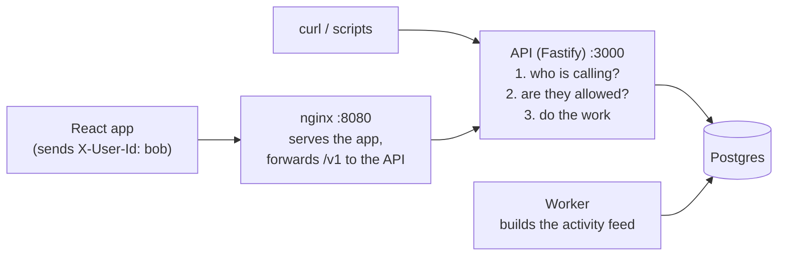
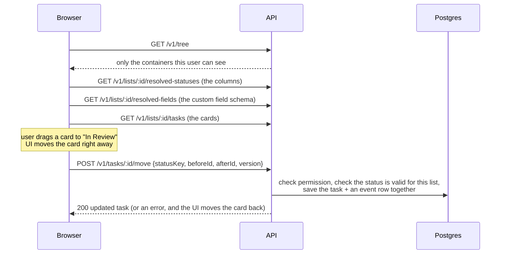

# Flowboard design

Draft for review, 2026-10-23. The assignment PDF (`docs/lead-engineer-tasks-module-take-home-candidate.pdf`) is the source of truth. The "why" behind each choice is in `docs/DECISIONS.md` (D-01, D-02, ...).

## 1. What we are building

A small project-management app. People organize work in a tree (workspace > space > folder > list), keep tasks in lists, and look at them as a kanban board or a table.

Three rules make it more than a CRUD app:

1. **Statuses depend on where a list sits.** Two lists can have different board columns.
2. **Custom fields depend on where a list sits.** A task in one list may have an "Estimate" field, and a task in another list a "Channel" field.
3. **Users see different parts of the tree.** Bob can't see what Alice can see.

Scope is exactly the PDF. Stretch goals (the PDF allows two): **optimistic drag-and-drop with conflict handling**, and, **only if time allows** after all required work and tests pass, **an activity feed built by a background worker**. If time runs out, the async path stays as a written design (the PDF accepts this). Deploy and other extras come after submission.

## 2. Choices I made where the assignment was open

| Question                                                     | My answer                                                                              | Why, in one line                                                                                     | Ref  |
| ------------------------------------------------------------ | -------------------------------------------------------------------------------------- | ---------------------------------------------------------------------------------------------------- | ---- |
| Can a list sit directly in a space?                          | No. A list is always inside a folder.                                                  | The PDF lists exactly 4 levels. One fixed shape keeps the code simple.                               | D-04 |
| What does a task store for its status?                       | A short fixed key like `"in_review"`, not a database id.                               | The same status can be renamed at different levels, and the key stays the same. The PDF allows this. | D-06 |
| How do statuses inherit?                                     | Merge by key (section 5).                                                              | Lets a child add, rename, recolor, reorder or hide statuses without copying the parent's.            | D-05 |
| Can two custom fields share a key?                           | No. Each field key is unique in the workspace.                                         | `estimate` is always a number everywhere, so moving tasks between lists is safe.                     | D-08 |
| What happens if you remove a status that tasks use?          | Refused with an error listing those tasks.                                             | The board can never have a card with no column.                                                      | D-07 |
| What happens if you delete a custom field that tasks use?    | The field is hidden. Task values are kept but not shown.                               | Cheap, reversible, no mass data rewrite.                                                             | D-09 |
| What happens when a task moves to a list without its status? | Map it to a status of the same kind. If there's none, refuse.                          | Keeps "this is in progress" true across lists.                                                       | D-10 |
| Who can change statuses, fields, containers and permissions? | Admins only. Members work on tasks.                                                    | Simplest safe rule.                                                                                  | D-13 |
| Delete a container?                                          | Archived (hidden, restorable). Tasks are deleted for real.                             | Archiving a whole folder must be undoable.                                                           | D-11 |
| A field becomes required later. Do old tasks break?          | No. Required is checked when creating or moving a task, and you can't clear the value. | Otherwise every old task fails on an unrelated edit, like a drag.                                    | D-09 |
| Two people edit the same task at once?                       | Each save sends the task's `version`. A stale version is refused (409).                | No silent overwrites.                                                                                | D-22 |

## 3. The pieces and how they talk



- **Browser and curl are untrusted.** Anything they send is checked.
- **The API** checks who you are on every request (section 9), checks permission (section 8), validates the input, then reads or writes the database.
- **The worker** is a second small process. It reads events that the API saved and turns them into the activity feed (section 12).
- **nginx** serves the built React files and forwards `/v1` calls to the API, so the browser talks to one address (no CORS setup needed).

### Opening a board, then dragging a card



## 4. The tree

```
Workspace "Flowboard"        default statuses: To Do, In Progress, Done, Closed
├── Space "Engineering"      field: estimate (number)
│   ├── Folder "Q4 Launch"   fields: severity (dropdown, required), component (multi-select)
│   │   ├── List "Backlog"   uses everything above as is
│   │   └── List "Sprint 12" statuses: adds In Review, renames Done to "Shipped", hides Closed
│   │                        field: needs_qa (checkbox)
│   └── Folder "Platform"    statuses: adds Blocked (active), placed after In Progress
│       └── List "On-call"   inherits Blocked from its folder. Bob is denied here
└── Space "Marketing" (private)  own statuses: Idea, Drafting, Scheduled, Published
    └── Folder "Campaigns"       fields: channel (dropdown, required), publish_date (date)
        └── List "Launch Content"
```

This is also the seed data. Statuses are set at all four levels (workspace defaults, Marketing space, Platform folder, Sprint 12 list), so the demo and tests show inheritance from every level, as the PDF FAQ requires.

- **Depth is fixed:** workspace (one) > space > folder > list. Tasks live in lists. The database refuses anything else, such as a folder inside a folder.
- **All four types are stored in one `containers` table** with a `type` column. Statuses, fields and permissions all point at a container the same way.
- **Order of siblings** is stored as a sortable string (`"a0"`, `"a1"`, `"a0V"`). To put an item between two others, the server makes a string that sorts between theirs, so only one row changes. The client just says "put it between item X and item Y".
- **Reorder** a container among its siblings: `POST /v1/containers/:id/move { beforeId, afterId }`. Moving to a different parent isn't supported (the PDF asks for sibling reorder only).
- **Delete** a container: it gets an `archived_at` date and disappears, with everything under it. The data stays in the database. (No restore endpoint; it's listed under later work.)
- **The tree endpoint** returns a flat list of visible containers, each with `parentId`. The sidebar nests them.

## 5. Statuses (merge by key)

Each status has a fixed `key` (like `todo`), a `name`, a `color`, a `position`, and a `category`, one of `not_started | active | done | closed`. The category is what the status means. The name is just its label.

Any container can have status rows. To get a list's statuses, walk from the workspace down to the list and merge each level's rows by key:

```ts
// rowsByLevel = [workspaceRows, spaceRows, folderRows, listRows]
function resolveStatuses(rowsByLevel: StatusRow[][]): Status[] {
  const result = new Map<string, Status>();
  for (const rows of rowsByLevel) {
    for (const row of rows) {
      const existing = result.get(row.key);
      if (!existing)
        result.set(row.key, row); // new key: ADD
      else if (row.hidden)
        result.delete(row.key); // hidden: HIDE
      else result.set(row.key, { ...existing, ...changes(row) }); // OVERRIDE name/color/position
    }
  }
  return [...result.values()].sort(byPosition);
}
```

**Example, Sprint 12:**

```
workspace rows:  todo, in_progress, done, closed
Sprint 12 rows:  in_review (new, placed after in_progress)
                 done -> name "Shipped"
                 closed -> hidden
result:          To Do | In Progress | In Review | Shipped
```

Backlog has no rows of its own, so it shows To Do | In Progress | Done | Closed.

**Rules the server enforces:**

1. Every list must end up with at least one `not_started`, one `active` and one `done` status.
2. Every task's status key must be in its list's result.
3. An override can't change the category. `done` means done everywhere.
4. Keys never change after creation.
5. The same key can't be created at two places on one branch (for example in a folder and in a list below it). Only the higher one is the original; lower rows can only override it.

**How a status change is saved safely:**

```
start transaction
  lock the container being changed
  make the change
  for every list under that container:
    recompute its statuses
    is rule 1 still true?  is every task's status still in the result?
  if anything is broken: undo everything, return 409 with the list of problems
commit
```

Task saves lock the same containers, so a task save and a status change on the same branch wait for each other. Without this, a task could be saved with a status that was hidden a millisecond earlier.

**The tricky cases:**

| Case                                               | Result                                                        | Test |
| -------------------------------------------------- | ------------------------------------------------------------- | ---- |
| Hide or delete a status that tasks use             | 409 `STATUS_IN_USE`, listing those tasks. Nothing changes.    | T7   |
| A change leaves a list with no `done` status       | 409 `STATUS_SET_INCOMPLETE`                                   | T7   |
| Two lists in the same folder                       | Backlog and Sprint 12 show different columns                  | T2   |
| Create a task with a status that isn't in its list | 400, `details: [{ path: "statusKey" }]`                       | T3   |
| A status change at a folder breaks a list below it | 409 (the check covers every list under the changed container) | T7   |

## 6. Custom fields

A field definition has `key`, `name`, `type`, `required`, `options` (for dropdowns) and `position`. It belongs to a space, folder or list, and applies to every list below it.

**A list's fields** = the space's fields, then the folder's, then the list's own. Keys are unique in the workspace, so there's nothing to merge. Creating a second `estimate` field is refused (409 `FIELD_KEY_TAKEN`).

**Accepted values:**

| Type          | Value sent                            | Example                 |
| ------------- | ------------------------------------- | ----------------------- |
| text          | string (max 5000)                     | `"See PR #12"`          |
| number        | a real JSON number (`"5"` is refused) | `5`                     |
| single_select | one option id                         | `"opt_high"`            |
| multi_select  | array of option ids                   | `["opt_api", "opt_ui"]` |
| date          | `YYYY-MM-DD`                          | `"2026-11-02"`          |
| checkbox      | boolean                               | `true`                  |

- Send `null` to clear a value.
- Keys not in the list's fields are refused.
- All problems come back at once:
  ```json
  {
    "error": {
      "code": "VALIDATION_FAILED",
      "message": "Invalid task",
      "details": [{ "path": "customFields.estimate", "code": "invalid_type", "message": "Expected number" }]
    }
  }
  ```
- The same validation function is shared with the frontend, so the form shows the same errors as the server.

**Changing a field definition:**

| Change                                  | Result                                                                                                                                                  |
| --------------------------------------- | ------------------------------------------------------------------------------------------------------------------------------------------------------- |
| Delete                                  | Field is hidden. Task values stay in the database but aren't returned. The key can't be reused, so old values can never show up under a different type. |
| Change type while tasks use it          | 409 `FIELD_IN_USE`                                                                                                                                      |
| Remove a dropdown option that tasks use | 409 `FIELD_OPTION_IN_USE`                                                                                                                               |
| Make it required                        | Allowed. Not checked on old tasks until they are moved.                                                                                                 |

## 7. Tasks

A task has `title` (required, max 500), `description`, `statusKey`, `priority` (urgent, high, normal, low, none), `assigneeIds`, `dueDate`, `customFields`, `position` (order inside its column), `version`, `createdAt` and `updatedAt`.

| Action                                      | Endpoint                                                                                                                                                                 |
| ------------------------------------------- | ------------------------------------------------------------------------------------------------------------------------------------------------------------------------ |
| List tasks of a list (paged)                | `GET /v1/lists/:listId/tasks?sort=position\|dueDate\|priority&cursor=...`                                                                                                |
| Create                                      | `POST /v1/lists/:listId/tasks`                                                                                                                                           |
| Read                                        | `GET /v1/tasks/:id`                                                                                                                                                      |
| Edit                                        | `PATCH /v1/tasks/:id` (must include `version`): title, description, priority, assignees, due date, custom fields. Status, list and position change only through `/move`. |
| Drag / change column / move to another list | `POST /v1/tasks/:id/move { listId?, statusKey?, beforeId?, afterId?, customFields?, version }`                                                                           |
| Delete                                      | `DELETE /v1/tasks/:id`                                                                                                                                                   |

**Moving to another list:**

1. If the request names a `statusKey`, it must exist in the new list.
2. Otherwise, if the new list has the same key with the same category, keep it.
3. Otherwise, use the new list's first status with the same category. Example: Sprint 12 "In Review" (active) moved to Backlog becomes "In Progress".
4. Otherwise, refuse with 409 `STATUS_UNMAPPABLE`, and the UI asks the user to pick one. Only `closed` can hit this, because every list has the other three categories.
5. Required fields of the new list must be filled, from the task's existing values or from `customFields` in the request. Otherwise 400.
6. Values for fields the new list doesn't have are kept but hidden, so moving back restores them.

**Two people saving at once:**

- Every save must send the `version` the client loaded.
- If someone saved first, the version no longer matches, and the server returns 409 `VERSION_CONFLICT` with the latest task. The UI reloads it.

## 8. Who can see what

Each container is `public` or `private`. A grant gives one user `allow` or `deny` on one container.

```ts
function canView(user, path /* [space, folder, list] */) {
  if (user.role === 'admin') return true;
  return path.every((c) => {
    const grant = grantFor(user, c);
    if (grant === 'deny') return false;
    if (grant === 'allow') return true;
    return c.visibility === 'public';
  });
}
```

In words: you see a list only if you're allowed at every step of its path. A deny higher up hides everything below it.

**Seeded users:**

| User  | Role   | Grants             | Sees                                                            |
| ----- | ------ | ------------------ | --------------------------------------------------------------- |
| Alice | admin  | none needed        | everything                                                      |
| Bob   | member | deny on On-call    | Engineering, without On-call. No Marketing (private, no allow). |
| Carol | member | allow on Marketing | everything                                                      |

- The tree endpoint removes what you can't see.
- Asking directly for something you can't see returns **403**. Something that doesn't exist (or is archived) returns **404**.
- Members can read and edit tasks in lists they can see. Only admins change containers, statuses, fields and grants.

## 9. Login (mock)

- Every request sends `X-User-Id: alice` (or bob, carol).
- The server looks that name up in the `users` table. Missing or unknown returns **401**.
- The role comes from the database, never from the request.
- In production, this one piece would be replaced by real login (for example OIDC tokens). Nothing else changes, because the rest of the code only reads `request.user`.

## 10. API rules

- Everything is under `/v1`. A breaking change would go to `/v2`.
- Errors always look like `{ "error": { "code", "message", "details"? } }`.
- Status codes:
  - 400: bad input
  - 401: not logged in
  - 403: not allowed
  - 404: not found
  - 409: conflicts with current data (stale version, status in use, key taken)
  - 500: our bug (the response includes the request id)
- **Cursor pagination** on every collection that grows (users, tasks): `?limit=` (default 50, max 200) and `?cursor=`. Response:
  ```json
  { "data": [ ... ], "page": { "limit": 50, "nextCursor": "eyJpZCI6...", "hasMore": true } }
  ```
  The cursor is an opaque string: pass `page.nextCursor` back as `cursor` to get the next page. It encodes the last row's sort values, so pages stay correct when rows are added (no skipped or repeated rows, unlike `OFFSET`).
- **Complete sets** the UI must render whole (the tree, a list's statuses, a list's fields) return `{ data: [...] }` without paging. A board can't show half its columns.
- Every response has an `x-request-id` header. The same id is in the server logs, so a bug report can be traced.
- `/health` says the API is up, and `/ready` also checks the database.
- API docs (OpenAPI) are generated from the same Zod schemas and served at `/docs`.

| Method               | Path                                                                                                          | Who                      |
| -------------------- | ------------------------------------------------------------------------------------------------------------- | ------------------------ |
| GET                  | `/health`, `/ready`                                                                                           | anyone                   |
| GET                  | `/v1/me`, `/v1/users`                                                                                         | any user                 |
| GET                  | `/v1/tree`                                                                                                    | any user (filtered)      |
| POST                 | `/v1/containers`                                                                                              | admin                    |
| GET / PATCH / DELETE | `/v1/containers/:id`                                                                                          | can view / admin / admin |
| POST                 | `/v1/containers/:id/move` (reorder among siblings)                                                            | admin                    |
| GET                  | `/v1/containers/:id/statuses` (own rows + the merged result)                                                  | can view                 |
| PUT / DELETE         | `/v1/containers/:id/statuses/:key` (add, override, hide or reorder via `beforeKey/afterKey` / remove own row) | admin                    |
| GET / POST           | `/v1/containers/:id/fields`                                                                                   | can view / admin         |
| PATCH / DELETE       | `/v1/fields/:id`                                                                                              | admin                    |
| GET / PUT / DELETE   | `/v1/containers/:id/grants[/:userId]`                                                                         | admin                    |
| GET                  | `/v1/lists/:id/resolved-statuses`, `/v1/lists/:id/resolved-fields`                                            | can view                 |
| GET / POST           | `/v1/lists/:id/tasks`                                                                                         | can view                 |
| GET / PATCH / DELETE | `/v1/tasks/:id`                                                                                               | can view                 |
| POST                 | `/v1/tasks/:id/move`                                                                                          | can view both lists      |
| GET                  | `/v1/tasks/:id/activity` (only if the activity feed is built)                                                 | can view                 |

## 11. Database tables

| Table                | Holds                                           | Notes                                                                                           |
| -------------------- | ----------------------------------------------- | ----------------------------------------------------------------------------------------------- |
| `users`              | Alice, Bob, Carol                               | `handle` ("alice"), `role` (admin/member)                                                       |
| `containers`         | workspace, spaces, folders, lists               | `type`, `parent_id`, `position`, `visibility`, `archived_at`. The DB checks valid parent types. |
| `status_definitions` | status rows per container                       | `container_id`, `key`, `name`, `category`, `color`, `position`, `hidden`                        |
| `field_definitions`  | custom field definitions                        | `container_id`, `key` (unique), `type`, `required`, `options` (JSON), `archived_at`             |
| `tasks`              | tasks                                           | `list_id`, `status_key`, `priority`, `due_date`, `custom_fields` (JSON), `position`, `version`  |
| `task_assignees`     | who is on which task                            | one row per (task, user)                                                                        |
| `grants`             | allow/deny per user per container               | one row per (container, user)                                                                   |
| `outbox`             | events like "task moved", saved with the change | only if time allows: read by the worker                                                         |
| `activity`           | the activity feed                               | only if time allows: written by the worker                                                      |

- **IDs** are UUIDs that Postgres generates in time order (`uuidv7()`).
- **Custom field values** live in a JSON column on the task. Postgres can still search inside it with an index.
- **Indexes** (pre-sorted lookups) cover the common reads: children of a container, tasks of a list by column and order, tasks by due date and priority, and searching inside custom field values.
- **What the database can't check by itself:** whether a task's status and field values are valid for its list. That depends on the whole path, so the API checks it inside the same transaction as the save.

## 12. Activity feed (background worker, only if time allows)

1. When the API saves a task change, it also saves an event row in `outbox`, in the same transaction. Either both are saved or neither is.
2. The worker checks `outbox` every second, takes a batch of new events, writes an `activity` row for each ("Alice moved Fix login to Done"), and marks the event done.
3. If the worker crashes halfway, it processes the same event again later. The `activity` row uses the event id as its key, so the duplicate is ignored.
4. If writing fails, it retries with growing delays. After 10 tries the event stays in the table for someone to inspect.
5. The feed may lag about a second behind. That's acceptable for an activity feed.

Several workers can run at once without taking the same event, because Postgres hands each locked row to only one of them (`FOR UPDATE SKIP LOCKED`).

The event JSON is also what other channels (webhooks, mobile) would receive:

```json
{
  "id": "0192...",
  "type": "task.moved",
  "occurredAt": "2026-10-24T10:00:00Z",
  "actor": { "id": "...", "handle": "alice" },
  "task": { "id": "...", "listId": "...", "version": 7 },
  "changes": { "statusKey": { "from": "in_progress", "to": "in_review" } }
}
```

## 13. Frontend

React + TypeScript + Vite, built as a single-page app: static files served by nginx, all data from our API (D-01). Libraries:

- TanStack Query for server data
- React Router (the selected list, view and open task live in the URL)
- Pragmatic drag and drop (Atlassian's library behind Jira and Trello boards)
- React Hook Form + Zod for forms
- Mantine for ready-made UI components

**Screens:**

- **Header:** user switcher (Alice, Bob, Carol). The choice is saved in localStorage and sent as `X-User-Id`. Switching clears cached data.
- **Sidebar:** the tree. Click a list to open it.
- **Board:**
  - One column per resolved status.
  - Cards show title, assignee initials, priority, due date, and one custom field chip.
  - Drag with the mouse. For keyboard users, each card has a "Move to..." menu (column and position), which is Atlassian's recommended accessible alternative to dragging.
  - The card moves immediately. If the server refuses, it moves back and a message explains why.
- **Table:** built-in columns plus one column per custom field, sortable by due date and priority. Click a row to open the drawer.
- **Task drawer:** built-in fields plus one input per custom field, generated from the field schema. Server errors appear next to the right input.
- **Settings page per container:**
  - Statuses: shows the merged result (with where each status comes from), and lets an admin add, rename, recolor, hide, reorder or remove this container's own rows.
  - Fields: add, edit or delete.
- **Every view has loading, empty and error states.** For example "No tasks yet", or "You don't have access to this list" on a 403.

## 14. Running it

```
docker compose up --build
  db       Postgres 18
  migrate  creates tables, adds seed data on first run, then exits
  api      http://localhost:3000   (docs at /docs)
  worker   activity feed
  web      http://localhost:8080   (open this)
```

- `make seed` resets the data.
- `make test` runs all tests in Docker.
- `.env.example` lists settings. There are no secrets.

## 15. Tests

Backend tests call the real API against a real test database. No mocks, because many rules live in the database.

| #   | What                        | Checks                                                                                                                                                                                                                            |
| --- | --------------------------- | --------------------------------------------------------------------------------------------------------------------------------------------------------------------------------------------------------------------------------- |
| T1  | Permissions                 | Bob's tree has no Marketing and no On-call, and Alice's has everything. Bob reading On-call tasks gets 403. No `X-User-Id` gets 401.                                                                                              |
| T2  | Sibling lists + inheritance | Backlog: todo, in_progress, done, closed. Sprint 12: todo, in_progress, in_review, done ("Shipped"). On-call inherits from its folder: todo, in_progress, blocked, done, closed. Launch Content inherits the Marketing space set. |
| T3  | Bad status                  | Create or move with `statusKey: "nope"` gets 400 with path `statusKey`. `in_review` is fine in Sprint 12 and refused in Backlog.                                                                                                  |
| T4  | Moving between lists        | In Review to Backlog becomes In Progress. Closed to Sprint 12 gets 409, and works when `statusKey` is given. Missing required field gets 400, and works when the value is sent.                                                   |
| T5  | Field types                 | `"5"` for a number gets 400 at `customFields.estimate`. Unknown dropdown option gets 400. A valid value of each type saves and reads back the same.                                                                               |
| T6  | Required fields             | Create in Backlog without `severity` gets 400. Clearing `severity` gets 400.                                                                                                                                                      |
| T7  | Status safety               | Hiding a status in use gets 409 listing the task, and nothing changed. After moving that task, hiding works. Removing the only `done` gets 409. No task ends up outside the board's columns.                                      |
| T8  | Field changes               | Type change in use gets 409. A deleted field is hidden but its data is kept. Reusing the key gets 409.                                                                                                                            |
| T9  | Stale save                  | Edit with an old `version` gets 409.                                                                                                                                                                                              |
| T10 | Error shape                 | Every error response in the suite has the `{ error: { code, message } }` shape.                                                                                                                                                   |

Frontend:

- One browser test (Playwright): open Sprint 12, check the four columns, open a task, change Estimate, save, reopen, and check the value stuck.
- A bonus browser test: as Alice "Launch Content" is in the sidebar. Switch to Bob and it's gone.
- One component test: each custom field type renders the right input.

## 16. Growing it later

- **More traffic:** the API keeps no state in memory, so we can run more copies behind a load balancer. More workers can run too.
- **Big lists:** load the board one column at a time (`?statusKey=...` with paging).
- **Slow status/field lookups:** cache the merged result per list and clear it when config changes. Not built, because it's not needed yet.
- **Filtering by custom fields:** the JSON index handles "equals". Ranges (dates, numbers) would need extra indexes or a search engine.
- **First things to split into separate services (weeks 2-4):**
  1. Activity, notifications and search, all fed from the outbox events. They shouldn't slow down task saves.
  2. Search, once filters span many lists.
  3. Status/field config, if other products (like CRM contacts) start using the same field engine.

  Tasks, tree and permissions stay together, because every task save needs all three in one transaction.

## 17. Build order

Each step is committed with its tests:

- (a) project skeleton, Docker, tables, seed data, login, health, error format
- (b) tree, status merging, field definitions (tests T2, T7, T8)
- (c) tasks, validation, move and reorder (T3-T6, T9)
- (d) permissions (T1)
- (e) frontend: sidebar, board, table, drawer, settings
- (f) browser and component tests
- (g) stretch goals: optimistic drag-and-drop first, then the activity feed only if time allows
- (h) README, AI_USAGE.md, interview prep notes

## 18. Later (beyond the PDF, not built now)

Good production additions, deliberately left out to keep the submission to the PDF's scope:

- **Deploy** to Fly.io, Railway or Render, with the same compose services.
- **Rate limiting** per user (`@fastify/rate-limit`).
- **Error tracking** (Sentry) on the API and the web app.
- **Metrics and tracing** (OpenTelemetry for HTTP and Postgres, RED metrics per route).
- **Security headers** at nginx (CSP, HSTS).
- **Real login** (OIDC), replacing the `X-User-Id` plugin (section 9).
- **Keyboard dragging** in addition to the "Move to..." menu.
- **Moving containers to a new parent** (would re-run the status safety check), a **restore** endpoint for archived containers, and **reordering custom fields**.
- **How this would grow for a CRM:** custom fields on contacts and deals using the same field engine, automation triggers on status change fed by the outbox events, and webhooks built on the same event payload.
