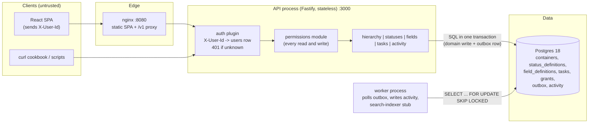

# Flowboard design

Status: draft for review, 2026-10-23. Source of truth for requirements: `docs/lead-engineer-tasks-module-take-home-candidate.pdf`.
Rationale and rejected alternatives for each choice live in `docs/DECISIONS.md` (referenced as D-xx).

## 0. How I read the assignment

Scope is exactly the PDF. Stretch goals (the PDF allows at most two): **optimistic UI with conflict handling on drag-and-drop**, and **an activity feed via async IPC** (outbox + worker). Anything else is deferred until after submission: deploy, metrics and tracing, the CRM evolution notes.

Where the spec leaves room, I picked the simplest reading I can defend:

| Topic | Reading | Ref |
|---|---|---|
| Container nesting | Strict: workspace > space > folder > list. A list's parent is always a folder (no folderless lists). | D-04 |
| Status on a task | Tasks store a stable `statusKey` (the spec allows "statusId or stable statusKey"). Under merge-by-key inheritance, the key is the identity. | D-06 |
| Status inheritance | Merge by key, walking workspace > space > folder > list. A child can add, override name/color/position, or hide. A child can't change an inherited status's category. | D-05 |
| Custom field keys | Unique across the workspace. Fields are inherited but never overridden, so a key always means the same type. | D-08 |
| In-use status removal | Blocked with 409 and a list of affected tasks. | D-07 |
| In-use field removal | Soft delete: values stay on tasks as orphans and are hidden on read. The key stays reserved. | D-09 |
| Cross-list move | Keep the status if its key and category exist in the destination. Otherwise map to the destination's first status of the same category, otherwise 409. Missing required fields must be in the move payload. | D-10 |
| Who edits config | Admins only (statuses, fields, containers, grants). Members edit tasks in lists they can see. | D-13 |
| Containers delete | Archive (soft delete, `archived_at`). Tasks are hard deleted, and the outbox keeps the record. | D-11 |
| Required fields on update | Enforced on create and on move. On update you can't clear a required field, but a field made required later doesn't block unrelated edits on old tasks. | D-09 |

## 1. Architecture

One API process (modular monolith), one worker process built from the same image, Postgres. The web app is static files served by nginx, which also proxies `/v1` to the API so the browser sees one origin (no CORS).



**Trust boundary.** Everything left of the auth plugin is untrusted. The plugin turns `X-User-Id` into a `users` row, and the row's `role` comes from the database, never from the request. Permission checks run in the service layer of every route, so the UI hiding something is cosmetic only.

**Where config lives relative to the hierarchy.** Status definitions and field definitions are rows owned by a container (`container_id` FK). They are resolved on read for a given list by walking its ancestor path:

```
Workspace "Flowboard"        statuses: todo, in_progress, done, closed  (defaults)
├── Space "Engineering"      fields: estimate(number)
│   ├── Folder "Q4 Launch"   fields: severity(single_select, required), component(multi_select)
│   │   ├── List "Backlog"   (inherits everything)
│   │   └── List "Sprint 12" statuses: +in_review, done renamed "Shipped", closed hidden
│   │                        fields: needs_qa(checkbox)
│   └── Folder "Platform"
│       └── List "On-call"   (Bob denied)
└── Space "Marketing" (private)  statuses: idea, drafting, scheduled, published (+ hides defaults)
    └── Folder "Campaigns"       fields: channel(single_select, required), publish_date(date)
        └── List "Launch Content"
```

**Request flow: load board, then drag a card.**

```mermaid
sequenceDiagram
  participant B as Browser
  participant A as API
  participant DB as Postgres
  participant W as Worker
  B->>A: GET /v1/tree (X-User-Id: bob)
  A->>DB: containers + bob's grants
  A-->>B: tree filtered to what bob can see
  par board load
    B->>A: GET /v1/lists/:id/resolved-statuses
    B->>A: GET /v1/lists/:id/resolved-fields
    B->>A: GET /v1/lists/:id/tasks?limit=200
  end
  A->>DB: ancestor path + grants (assertCanView) then queries
  A-->>B: columns, field schema, tasks
  Note over B: user drags card to "In Review"<br/>cache updated optimistically
  B->>A: POST /v1/tasks/:id/move {statusKey, beforeId, afterId, version}
  A->>DB: BEGIN; lock list row, share-lock ancestors
  A->>DB: resolve statuses, validate key, compute position
  A->>DB: UPDATE task (version = version + 1) WHERE version = :version
  A->>DB: INSERT outbox(task.moved); COMMIT
  A-->>B: 200 task (or 409 VERSION_CONFLICT, client rolls back and refetches)
  W->>DB: claim outbox rows, INSERT activity ON CONFLICT DO NOTHING
```

## 2. Module boundaries

`apps/api/src/modules/<name>/` holds routes, service and SQL for one area. Modules call each other's services and never query another module's tables.

| Module | Owns tables | Exposes |
|---|---|---|
| identity | `users` | `resolveCaller(header)`, `listUsers` |
| hierarchy | `containers` | tree, `getPath(id)`, `listIdsInSubtree(id)`, CRUD, move |
| permissions | `grants` | `visibleTree(user)`, `assertCanView(user, id)`, `assertAdmin(user)` |
| statuses | `status_definitions` | `resolveForPath(path)`, config CRUD, `verifySubtree(id)` |
| fields | `field_definitions` | `resolveForPath(path)`, `validateValues(schema, values, mode)`, config CRUD |
| tasks | `tasks`, `task_assignees` | CRUD, move, counts by status/field for config checks |
| activity | `outbox`, `activity` | `record(event, tx)`, worker loop, feed read |

A transaction handle (`tx`) is passed through service calls so one request stays one transaction across modules.

Shared code lives in `packages/contracts`: Zod schemas for request and response bodies, plus the custom-field value validator. The API uses them for validation and OpenAPI, and the web app uses them for types and form validation. The server is still authoritative.

## 3. Data model (Postgres 18)

IDs are `uuid DEFAULT uuidv7()` (built into PG 18, time-ordered, so B-tree inserts stay local). Every table has `created_at`, and mutable ones have `updated_at`.

```sql
users (id, handle text unique, name, role text check in ('admin','member'))

containers (
  id, type container_type,              -- enum: workspace|space|folder|list
  parent_id uuid null, parent_type container_type null,
  name text, position text collate "C", -- fractional index
  visibility text check in ('public','private') default 'public',
  archived_at timestamptz null,
  unique (id, type),
  foreign key (parent_id, parent_type) references containers (id, type),
  check ( (type='workspace' and parent_id is null)
       or (type='space'  and parent_type='workspace')
       or (type='folder' and parent_type='space')
       or (type='list'   and parent_type='folder') )
)
-- the composite FK + check make an invalid parent impossible at the DB level

status_definitions (
  id, container_id fk containers, key text,
  name text null, category status_category null, color text null,
  position text collate "C" null, hidden boolean default false,
  unique (container_id, key)
)
-- a row is either an origin (defines key; name/category/color/position required)
-- or an override of an inherited key (category null; other columns optional; or hidden=true)

field_definitions (
  id, container_id fk containers, key text, name text, type field_type,
  required boolean, options jsonb default '[]',  -- [{id,label,color?}]
  position text collate "C", archived_at timestamptz null,
  unique (key)                                    -- single workspace; includes archived rows
)

tasks (
  id, list_id uuid, list_type container_type generated always as ('list') stored,
  foreign key (list_id, list_type) references containers (id, type), -- must be a list
  title text check (char_length(title) between 1 and 500),
  description text, status_key text not null,
  priority priority not null default 'none',      -- enum declared urgent,high,normal,low,none
  due_date timestamptz null, custom_fields jsonb not null default '{}',
  position text collate "C" not null, version int not null default 1,
  created_by fk users
)
task_assignees (task_id fk on delete cascade, user_id fk users, primary key (task_id, user_id))

grants (id, container_id fk, user_id fk, mode text check in ('allow','deny'), unique (container_id, user_id))

outbox (id, type text, aggregate_id uuid, actor_id uuid, payload jsonb,
        attempts int default 0, last_error text, available_at timestamptz,
        processed_at timestamptz null)
activity (event_id uuid primary key references outbox, task_id, actor_id, type, summary, created_at)
```

**Things the DB cannot express, enforced in the service layer inside the transaction:** a task's `status_key` must be in the resolved set for its list, and its custom field values must match the resolved schema. Both depend on the ancestor path, so no FK or CHECK can express them.

**Indexes**

| Index | Serves |
|---|---|
| `containers (parent_id, position) where archived_at is null` | tree build, sibling reorder |
| `tasks (list_id, status_key, position, id)` | board columns, in-use status checks |
| `tasks (list_id, due_date, id)`, `tasks (list_id, priority, id)` | list view sorts with keyset pagination |
| `tasks using gin (custom_fields jsonb_path_ops)` | custom field filters (`@>`), in-use option checks |
| `task_assignees (user_id)` | "my tasks" (future) |
| `grants (user_id)` | tree filtering |
| `outbox (available_at) where processed_at is null` | worker claim query |

## 4. Hierarchy

- One `containers` table for all four types (D-03). Workspace is the root row, which lets statuses use it as the default owner without a special case.
- Ordering: `position` is a fractional index string (D-12). The client sends `{beforeId, afterId}`, and the server computes a key between the two neighbors, so a move updates one row.
- Move/reparent: `POST /v1/containers/:id/move {parentId?, beforeId?, afterId?}`. Reparenting changes the resolved config of the subtree, so it runs the same `verifySubtree` check as a config change (section 5.4).
- Archive: `DELETE` sets `archived_at`. A node with an archived ancestor is treated as not found (404). `POST /v1/containers/:id/restore` undoes it. Tasks in archived lists still count for in-use checks, so restoring can never surface invalid tasks.

## 5. Status resolution

### 5.1 Algorithm (exact)

```
resolveStatuses(path)            # path = [workspace, space, folder, list], root first
  resolved = map key -> status
  for container in path:
    for row in rows(container):
      if row.key not in resolved:
        resolved[row.key] = row with origin = container        # origin row
      elif row.hidden:
        delete resolved[row.key]                               # hide
      else:
        apply row.name, row.color, row.position if not null    # override
        resolved[row.key].overriddenAt = container
  return values(resolved) sorted by (position, key)
```

Positions are fractional keys in one shared ordering space. This lets a list insert "In Review" between two inherited statuses by giving it a key between theirs.

### 5.2 Invariants (checked on every config write)

1. Every resolved set for every list in the affected subtree has at least one `not_started`, one `active` and one `done` status.
2. Every task's `status_key` is in the resolved set of its list.
3. Along any root-to-leaf path, a key has exactly one origin row (the topmost). So:
   - creating a new key at C is rejected (409 `STATUS_KEY_CONFLICT`) if C's ancestors or descendants already have a row with that key and it isn't an override of an inherited key;
   - an override can't set `category` (400);
   - an origin row can't be deleted while a descendant has an override row for that key (409, with the containers in `details`).
4. Keys are immutable and match `^[a-z][a-z0-9_]{0,39}$`.

### 5.3 Config write procedure ("apply, verify, commit")

```
BEGIN
  SELECT ... FROM containers WHERE id = :owner FOR UPDATE      # serializes with task writes below
  apply the change (insert/update/delete a status_definitions row)
  verifySubtree(owner):
    for each list L under owner (archived included):
      set = resolveStatuses(path(L))
      check invariant 1, else collect {listId, missingCategories}
      count tasks in L whose status_key not in set, else collect {listId, statusKey, taskCount, taskIds[<=20]}
  if anything collected: ROLLBACK, return 409 with details
COMMIT
```

Task writes lock their list row `FOR UPDATE` and the ancestor rows `FOR SHARE` before resolving. A config change at any ancestor therefore waits for in-flight task writes, and the reverse. Validation and config changes can't interleave, so we never get a task with a status that was hidden a moment earlier (D-14).

### 5.4 Hard cases

| Case | Behavior | Test |
|---|---|---|
| Hide/delete a status used by tasks | 409 `STATUS_IN_USE`, `details: [{listId, statusKey, taskCount, taskIds}]`, nothing changes | T7 |
| Change leaves a list without a `done` | 409 `STATUS_SET_INCOMPLETE` | T7b |
| Sibling lists with different sets | Backlog resolves 4 columns, Sprint 12 resolves 4 different ones | T2 |
| Unknown status on create/update | 400 `VALIDATION_FAILED`, `details: [{path: "statusKey", code: "unknown_status"}]` | T3 |
| Reparent list into a folder whose set lacks a used key | 409 `STATUS_IN_USE` (same verify) | T7c |

## 6. Custom fields

### 6.1 Resolution

```
resolveFields(path) = definitions of space, then folder, then list (not archived),
                      each level ordered by position
```

Keys are unique in the workspace (a DB unique index, archived rows included), so there is nothing to merge. A collision fails at definition time with 409 `FIELD_KEY_TAKEN`. Fields can't be overridden: a key is typed data on tasks, and letting one list redefine `estimate` as text would make the same key mean different things across lists, breaking moves and filters (D-08).

### 6.2 Value validation (shared validator in `packages/contracts`)

| Type | Accepted value | Stored as |
|---|---|---|
| text | string, max 5000 | string |
| number | finite JSON number (the string "5" is rejected) | number |
| single_select | an option id from `options` | string |
| multi_select | array of unique option ids | string[] |
| date | `YYYY-MM-DD`, a real calendar date | string |
| checkbox | boolean | boolean |

- `null` clears a value (removes the key from the jsonb).
- Unknown keys (not in the resolved schema) are rejected: `customFields.<key>` with code `unknown_field`.
- Errors return every problem at once: `details: [{path: "customFields.estimate", code: "invalid_type", message: "Expected number"}]`.
- Modes: `create` (required fields must be present and non-null), `update` (merge; required fields can't be set to null), `move` (destination's required fields must be present in existing values plus payload).

### 6.3 Definition changes

| Change | Behavior |
|---|---|
| Delete | Soft delete. Values stay in `tasks.custom_fields` but are left out of responses because they are not in the resolved schema. The key stays reserved, so a new field can't reinterpret old values. |
| Change `type` | 409 `FIELD_IN_USE` if any task has a value; allowed otherwise. |
| Remove a select option | 409 `FIELD_OPTION_IN_USE` if any task uses it. |
| Make `required` | Allowed. Not retroactive (see section 0). |
| Change `key` | Not allowed (immutable). |

## 7. Tasks

| Operation | Endpoint | Notes |
|---|---|---|
| list | `GET /v1/lists/:listId/tasks` | cursor pagination; `sort=position\|dueDate\|-dueDate\|priority`; `statusKey=` filter for per-column loading |
| create | `POST /v1/lists/:listId/tasks` | appended to the end of its column unless `beforeId/afterId` |
| read | `GET /v1/tasks/:id` | |
| update | `PATCH /v1/tasks/:id` | requires `version`; title, description, statusKey, priority, assigneeIds, dueDate, customFields (partial merge) |
| move | `POST /v1/tasks/:id/move` | `{listId?, statusKey?, beforeId?, afterId?, customFields?, version}`. One command for column change, reorder and cross-list move. |
| delete | `DELETE /v1/tasks/:id` | hard delete, emits `task.deleted` |

**Cross-list move policy (D-10).** One transaction locks both lists' paths, then:
1. If the payload has `statusKey`, it must be in the destination set (400 otherwise).
2. Else if the destination has the same key with the same category, keep it.
3. Else map to the destination's first status (by position) with the same category.
4. Else 409 `STATUS_UNMAPPABLE` with the destination's statuses in `details`, and the client retries with an explicit `statusKey`. This only happens for `closed`, because every set has the other three categories.
5. Validate custom fields in `move` mode. Values for keys the destination doesn't have are kept (orphans), so moving the task back restores them.

Both the "map" outcome (3) and the "reject" outcome (4) get tests (T4a, T4b).

**Concurrency.** `version` catches stale clients: an update with an old version returns 409 `VERSION_CONFLICT` and the current task. The list row lock serializes writers in one list, which also prevents two moves from computing the same fractional key.

## 8. Permissions

```
canView(user, node):
  if user.role == admin: return true
  for c in path(node) excluding workspace:          # space, folder, list
    g = grant(c, user)
    if g == deny: return false
    if g == allow: continue
    if c.visibility == private: return false
  return true
```

In words: a node is visible if every container on its path is either explicitly allowed or public and not denied. Deny on an ancestor hides the whole subtree, even if there's an allow lower down. An allow on a private list inside a space you can't see doesn't help, because the path has to be visible (D-15 covers why, and how I'd add "path-only" visibility later).

- Tree: load all non-archived containers plus the caller's grants (two queries), filter top-down in memory. At this scale a workspace has hundreds of containers.
- Single-resource checks: one recursive CTE gets the path (max depth 4) joined with the caller's grants.
- Invisible but existing → 403 `FORBIDDEN` (the spec asks for this). Missing or archived → 404.
- Members: read and write tasks in visible lists. Admins: everything, including containers, config and grants.
- Assignees aren't checked against visibility (documented gap).

Seeded grants: Bob is denied `On-call` and can't see private `Marketing`. Carol is allowed on `Marketing`. So Bob sees 3 of 4 lists, Carol sees all 4, and Alice is an admin.

## 9. Auth

- `X-User-Id: alice|bob|carol` is looked up by `users.handle`. A missing or unknown value returns 401 `UNAUTHENTICATED`. `request.user` is the only identity anything downstream reads.
- Production swap: replace the plugin with one that verifies an OIDC access token (JWKS, issuer, audience, expiry) and maps `sub` to a user row, or reads a server-side session cookie. Routes and services don't change. Documented in the README.

## 10. API conventions

- REST, all under `/v1`. Breaking changes go in `/v2`, and additive changes stay in v1.
- Errors: `{ error: { code, message, details? } }` from one Fastify error handler. Zod failures map to 400 `VALIDATION_FAILED` with `details: [{path, code, message}]`. Domain errors are typed classes (`NotFound`, `Forbidden`, `Conflict(code, details)`). An unknown error returns 500 `INTERNAL` with the request ID and no stack.
- Pagination: `?limit=` (default 50, max 200) and `?cursor=`, response `{ data, nextCursor }`. The cursor is opaque base64url of the last row's sort values plus id (keyset, stable under inserts). Config endpoints (statuses, fields) and the tree aren't paginated because they are small and bounded; the README explains this.
- OpenAPI 3 generated from the same Zod schemas, served at `/docs`.
- Every response carries `x-request-id`.

| Method | Path | Who |
|---|---|---|
| GET | `/health` (liveness), `/ready` (DB ping) | public |
| GET | `/v1/me`, `/v1/users` | any user |
| GET | `/v1/tree` | any user (filtered) |
| POST | `/v1/containers` | admin |
| GET, PATCH, DELETE | `/v1/containers/:id` | view / admin / admin |
| POST | `/v1/containers/:id/move`, `/v1/containers/:id/restore` | admin |
| GET | `/v1/containers/:id/statuses` (local rows + resolved preview with origin) | view |
| PUT, DELETE | `/v1/containers/:id/statuses/:key` (upsert local row: add, override, hide) | admin |
| POST | `/v1/containers/:id/statuses/:key/move {beforeKey, afterKey}` | admin |
| GET, POST | `/v1/containers/:id/fields` | view / admin |
| PATCH, DELETE | `/v1/fields/:id` | admin |
| GET, PUT, DELETE | `/v1/containers/:id/grants[/:userId]` | admin |
| GET | `/v1/lists/:id/resolved-statuses`, `/v1/lists/:id/resolved-fields` | view |
| GET, POST | `/v1/lists/:id/tasks` | view |
| GET, PATCH, DELETE | `/v1/tasks/:id` | view |
| POST | `/v1/tasks/:id/move` | view (source and destination) |
| GET | `/v1/tasks/:id/activity` | view |

## 11. Reliability, observability, async path

- **Logs:** Fastify's pino logger as JSON. Request IDs come from incoming `x-request-id` if present (so a proxy can set it), otherwise a new UUID. Each log line carries `reqId`, `userId`, route, status and duration. Worker logs carry `eventId`.
- **Health:** `/health` returns 200 if the process is up. `/ready` runs `select 1` and returns 503 if the DB is unreachable. The compose healthcheck and any platform probe use `/ready`.
- **Shutdown:** on SIGTERM, close the Fastify server (drain in-flight requests), then the pg pool. The worker finishes its current batch.
- **Outbox (D-16):** domain writes insert an `outbox` row in the same transaction, so an event exists if and only if the change committed. The worker polls every second:
  `UPDATE outbox SET attempts = attempts + 1 WHERE id IN (SELECT id ... WHERE processed_at IS NULL AND available_at <= now() ORDER BY id LIMIT 50 FOR UPDATE SKIP LOCKED) RETURNING *`.
  For each event it inserts `activity ... ON CONFLICT (event_id) DO NOTHING` (idempotent, because delivery is at least once), logs a search-indexer stub line, then sets `processed_at`. On failure it records `last_error` and pushes `available_at` back exponentially. After 10 attempts the row stays for inspection (dead letter). The activity feed is eventually consistent, typically about one second behind.
- **Event payload** (also the webhook contract for other channels):
  ```json
  { "id": "0192...", "type": "task.moved", "occurredAt": "...", "actor": {"id": "...", "handle": "alice"},
    "task": {"id": "...", "listId": "...", "version": 7},
    "changes": {"statusKey": {"from": "in_progress", "to": "in_review"}} }
  ```

## 12. Frontend

React 19 + TypeScript + Vite. Stack: TanStack Query (server state), TanStack Router (list id, view and open task in the URL), dnd-kit, React Hook Form + Zod, Mantine for UI primitives (D-18).

- **Layout:** header (user switcher alice/bob/carol, stored in localStorage and sent as `X-User-Id`; switching clears the query cache), sidebar tree, main area with Board | Table tabs, task drawer.
- **Routes:** `/lists/$listId?view=board|table&task=$taskId`, `/containers/$id/settings` (statuses and fields config).
- **Board:** columns from `resolved-statuses`. Cards show title, assignee initials, priority badge, due date and the first select field as a chip. dnd-kit with pointer **and keyboard sensors** (space to pick up, arrows to move, space to drop, escape to cancel) and screen reader announcements. Drops update the cache optimistically and roll back on error, showing a message (409 refetches).
- **Table:** title, status, assignees, priority, due date, plus one column per resolved field. Sort by due date and priority on the server.
- **Drawer:** built-in fields plus inputs generated from `resolved-fields`. The form schema is built with the shared validator, so client errors match server errors. Server `details[].path` errors are mapped back onto form fields.
- **States:** every data view has explicit loading (skeletons), empty ("No tasks in this list", "No lists visible to you") and error (message, request ID and retry) states. A 403 shows "You don't have access to this list".
- **Config UI:** per container, a "Resolved" table (with origin/overridden-at badges) and a "Local" editor: add a status, override name/color, hide, reorder, delete. Fields: add/edit/delete at any non-workspace level. 409 details are shown as a list of affected tasks.

## 13. Running

```
docker compose up --build
  db       postgres:18-alpine, healthcheck pg_isready, volume
  migrate  one-shot: run migrations, seed if empty     (api/worker wait for it to complete)
  api      :3000, healthcheck /ready
  worker   same image, different command
  web      nginx :8080, proxies /v1 and /docs to api
```

- `.env.example` holds DB URL and ports only (no secrets exist).
- `make seed`: reset and reseed.
- `make test`: backend tests in a container against a separate `flowboard_test` database, then Playwright against the running stack.
- Multi-stage Dockerfiles (pnpm install with frozen lockfile, build, slim runtime on Node 24 alpine).

## 14. Test plan

Backend: Vitest with Fastify `inject()` against real Postgres (no DB mocks, because the logic under test is partly SQL). Fixtures are built through the API or small factories per test file. Pure resolution functions get plain unit tests as well.

| # | Scenario | Asserts |
|---|---|---|
| T1 | Permissions | Bob's tree has no Marketing nodes and no On-call; Alice's has all; Bob `GET /v1/lists/<on-call>/tasks` returns 403 `FORBIDDEN`; Bob `GET /v1/tasks/<task in on-call>` returns 403; no header returns 401 |
| T2 | Sibling resolution | Backlog keys `[todo, in_progress, done, closed]`; Sprint 12 keys `[todo, in_progress, in_review, done]` with done named "Shipped" |
| T3 | Status validation | create with `statusKey: "nope"` returns 400 at `details[0].path = "statusKey"`; same for PATCH; `in_review` is valid in Sprint 12 and invalid in Backlog |
| T4a | Move, mapped | Sprint 12 task in `in_review` moved to Backlog ends up `in_progress` (first active) |
| T4b | Move, rejected | Backlog task in `closed` moved to Sprint 12 returns 409 `STATUS_UNMAPPABLE`, task unchanged; with explicit `statusKey: done` returns 200 |
| T4c | Move, required field | Marketing task moved to Backlog without `severity` returns 400 at `customFields.severity`; with it in the payload returns 200 |
| T5 | Custom field types | `estimate: "5"` returns 400 at `customFields.estimate` (`invalid_type`); unknown option returns 400 (`invalid_option`); multi-select with an unknown id returns 400; a valid payload of all six types returns 201 and round-trips |
| T6 | Required | create in Backlog without `severity` returns 400 (`required`); PATCH `severity: null` returns 400 |
| T7 | Config safety | hide `closed` on Q4 Launch while a Backlog task uses it returns 409 `STATUS_IN_USE` with that task id, and the resolved set and task are unchanged; after moving the task, the hide succeeds; deleting the workspace `done` returns 409 `STATUS_SET_INCOMPLETE`; the board query returns zero tasks outside the resolved columns |
| T8 | Field definition changes | type change in use returns 409; deleting a field hides values in the response but keeps them in the DB; reusing the key returns 409 |
| T9 | Concurrency | PATCH with a stale `version` returns 409 `VERSION_CONFLICT` |
| T10 | Error shape | every non-2xx response in the suite matches the error schema (a shared assertion helper) |

Frontend:
- Playwright E2E (required path): select Sprint 12, assert columns `To Do, In Progress, In Review, Shipped`, open a task, change `estimate`, save, reopen and assert the value persisted.
- Playwright bonus: as Alice "Launch Content" is in the sidebar; switch to Bob and it disappears.
- One Vitest + RTL component test for the custom field input renderer (each type renders the right control and reports values).

## 15. Scale notes and what would split out

- **Stateless API:** no in-process session or cache, so the API tier scales horizontally behind any load balancer. The worker scales too, because `SKIP LOCKED` lets several workers share the outbox without double processing.
- **Hot reads:** resolved statuses and fields are a pure function of the path's config rows (a handful of tiny indexed queries). If profiling showed it mattered, I'd cache the resolution per list keyed by a workspace `config_version` counter bumped in the config transaction. Not built, because there's no evidence it's needed.
- **Board load:** one index range scan per list on `(list_id, status_key, position)`. Very large lists switch to per-column pagination (`statusKey` + cursor).
- **Custom field filters:** `custom_fields @> '{"severity":"opt_high"}'` uses the GIN index. Range filters on numbers or dates need expression indexes per hot field, or a search index.
- **Weeks 2-4 splits**, in this order:
  1. Activity/notifications/search consumers off the outbox (already a separate process). They have different scaling and failure profiles and must not slow task writes.
  2. A search service (Postgres FTS first, then OpenSearch fed by the outbox) once filters span lists.
  3. Config/schema (statuses + fields) as a read-heavy service with caching, if other products (CRM objects) start using the same field engine.
  Hierarchy, permissions and tasks stay together longer, because every task write needs a consistent view of the path and grants in one transaction.

## 16. Build order

Each step is committed with its tests:
(a) skeleton, compose, migrations, seed, auth, health, logging, error handler;
(b) hierarchy, status resolution, field schema, T2, T7, T8;
(c) tasks, validation, move/reorder, T3-T6, T9;
(d) permissions, T1;
(e) frontend: sidebar, board, table, drawer, config UI;
(f) Playwright and component test;
(g) stretch;
(h) README, diagrams, AI_USAGE.md, INTERVIEW_PREP.md.
